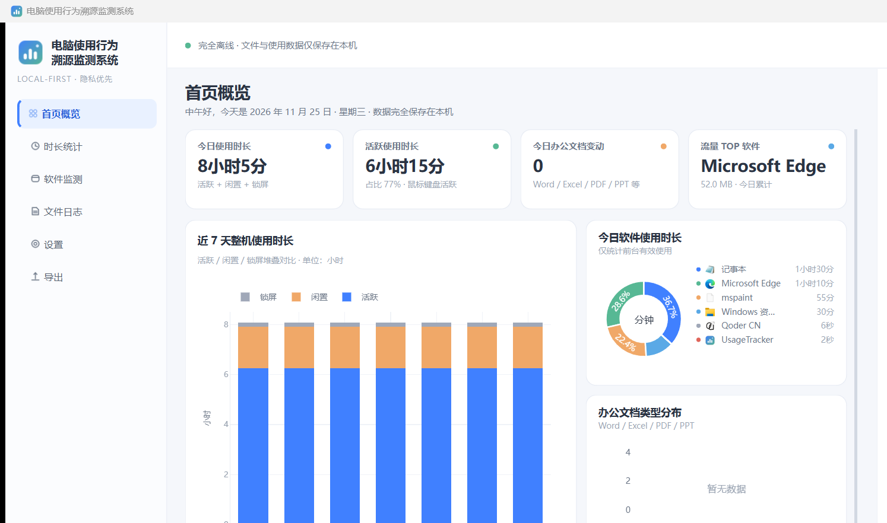

# 电脑使用行为溯源监测系统

> Windows 桌面端 · 纯本地离线 · 隐私优先 · 低占用后台监测

使用 Python + PyQt6 + SQLite 构建的本地电脑使用记录工具。所有记录只保存在本机，**运行时不联网、不上传数据**。



## 主要功能

- **总览**：今日使用时长、活跃 / 闲置 / 锁屏、软件使用占比、近 7 天趋势。
- **软件监测**：前台有效使用时长、后台时长、今日累计流量与实时下载 / 上传速率；整页统一滚动查看全部软件。
- **文件溯源**：新建、修改、重命名、删除记录，推断操作软件，支持 Office 文档分组与关键词筛选。
- **软件使用提醒**：按软件设置每日前台时长上限，达到上限温和提醒，次日自动重新计数。
- **系统提醒**：连续使用、久坐、流量异常等提醒，阈值与冷却时间均可配置。
- **流量统计**：整机流量始终可用；管理员模式下按软件归属 TCP 连接流量。
- **数据导出**：使用明细、文件日志与流量统计导出为 Excel / HTML 报告。
- **桌面体验**：柔和蓝色深浅主题、折叠导航、系统托盘、暂停采集、开机自启、自动清理。

## 隐私与数据

- 运行时完全离线，不包含网络上传逻辑。
- 默认数据目录：`%LOCALAPPDATA%\ComputerUsageTracker`。
- 可通过环境变量 `CUT_DATA_DIR` 指定其他数据目录，便于隔离测试。
- 首次启动显示隐私说明；设置页支持清理历史与调整数据目录。
- 这是一款自用 / 授权管理工具。请只在你拥有或已获得明确授权的电脑上启用监测。

## 快速开始

### 运行打包版本

按下方打包步骤生成程序后，打开 `dist/UsageTracker/UsageTracker.exe`。分享时请压缩整个 `UsageTracker` 目录。

按软件统计流量需要管理员身份：在设置页点击「以管理员身份重启」，或右键 exe 选择「以管理员身份运行」。非管理员时自动降级为仅整机统计，界面会明确说明。

### 从源码运行

要求：**Windows 10 / 11 64 位，Python 3.12**。

```powershell
git clone https://github.com/cikn2233/computer-usage-tracker.git
cd computer-usage-tracker

py -3.12 -m venv .venv
.\.venv\Scripts\Activate.ps1
python -m pip install -r requirements.txt
python main.py
```

首次安装依赖需要联网；程序运行本身完全离线。

## 打包

```powershell
python -m pip install pyinstaller
python -m PyInstaller UsageTracker.spec --noconfirm
```

产物位于 `dist/UsageTracker/UsageTracker.exe`。该 spec 为 **onedir** 模式，发布时请连同整个目录一起压缩，不要只发 exe。

## 技术栈

| 模块 | 技术 |
| --- | --- |
| 桌面界面 | PyQt6 / Qt Widgets |
| 离线图表 | Plotly（本地 plotly.min.js，无 CDN） |
| 数据存储 | SQLite（WAL） |
| 进程 / 网络 | psutil、Windows IP Helper（TCP ESTATS） |
| 文件监听 | watchdog |
| Excel 导出 | openpyxl |
| 打包 | PyInstaller |

## 目录结构

```text
app/
  config.py          配置与本地数据目录
  database.py        SQLite 结构与数据访问
  monitors/          时长、进程、文件、流量、提醒采集器
  ui/                PyQt6 页面、主题与 Plotly 图表
  utils.py           名称、时长、字节等工具函数
main.py              程序入口
UsageTracker.spec     PyInstaller 打包配置
requirements.txt     Python 依赖
```

## 常见问题

**为什么按软件流量是空的？**  
需要管理员权限，且只统计 TCP 连接；IPv6 / UDP 不包含在按软件流量口径中。

**为什么关闭窗口后还在记录？**  
这是设计行为：关闭主窗口会最小化到托盘，从托盘菜单可暂停或退出。

**为什么同一个软件出现两行？**  
程序按 exe 路径去重；不同安装路径或不同 exe 会分成多行，名称相同不代表同一路径。

## 开源协议

[MIT License](LICENSE)。欢迎提交 Issue 与 Pull Request；涉及监测范围或隐私行为的改动请在说明中重点标注。